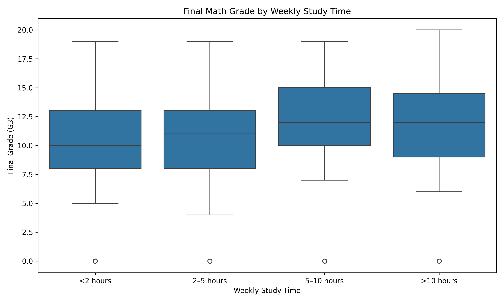
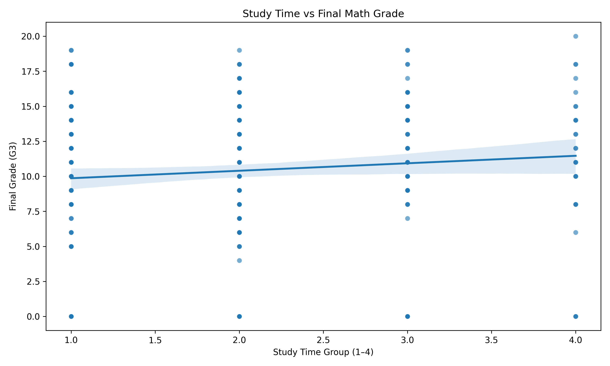

# Student Test Preparation Statistical Analysis

## Project Overview

This project investigates whether weekly study time is associated with higher final math grades among secondary school students.

The analysis uses the UCI Student Performance dataset and applies descriptive statistics, Spearman correlation, and data visualization to explore the relationship between study time and final academic performance.

## Research Question

**Is more weekly study time associated with higher final math grades?**

## Dataset

The dataset contains information about students' academic performance, study habits, demographics, and other factors.

The analysis focuses on:

- `studytime` — weekly study time
- `G3` — final math grade, measured from 0 to 20

### Study Time Categories

| Code | Weekly Study Time |
|---|---|
| 1 | Less than 2 hours |
| 2 | 2–5 hours |
| 3 | 5–10 hours |
| 4 | More than 10 hours |

## Statistical Methods

The project uses:

- Descriptive statistics to summarize final grades
- Grouped analysis to compare grades across study-time categories
- Spearman correlation to measure the association between study time and final grade
- Boxplots to compare grade distributions
- Scatter plots to visualize the relationship between study time and grades

## Tools Used

- Python
- Pandas
- SciPy
- Matplotlib
- Seaborn

## Project Structure

```text
student-test-preparation-analysis/
├── data/
│   └── student-mat.csv
├── analysis.py
├── requirements.txt
├── .gitignore
├── README.md
├── grade_by_studytime.png
└── studytime_vs_grade.png
## Results

The analysis found a Spearman correlation of **0.105** between weekly study time and final math grade.

The p-value was **0.0367**, which is below the 0.05 significance level. This suggests that there is a statistically significant association between study time and final grade in this dataset.

However, the correlation is **weak**, meaning that study time alone does not explain much of the variation in students' final grades.

## Key Findings

- The relationship between study time and final grade was positive.
- The association was statistically significant at the 0.05 level.
- The strength of the relationship was weak.
- Other factors may also contribute to students' academic performance.

## Limitations

This analysis has several limitations:

- The dataset represents students from two Portuguese secondary schools, so the findings may not apply to all students.
- Study time is reported in categories rather than exact hours.
- The analysis identifies an association, not causation.
- Other factors that may influence grades were not included in this research question.

## Conclusion

The results suggest that students who report more weekly study time tend to have slightly higher final math grades. However, the relationship is weak, so study time alone is not a strong predictor of final academic performance.

Further analysis could investigate other factors, such as absences, parental education, or previous academic performance.
## Visualizations

### Final Math Grade by Weekly Study Time



### Study Time vs Final Math Grade

